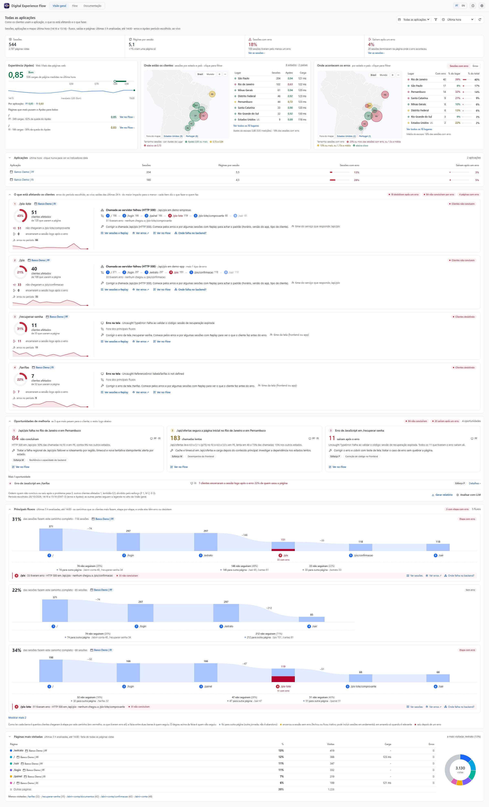
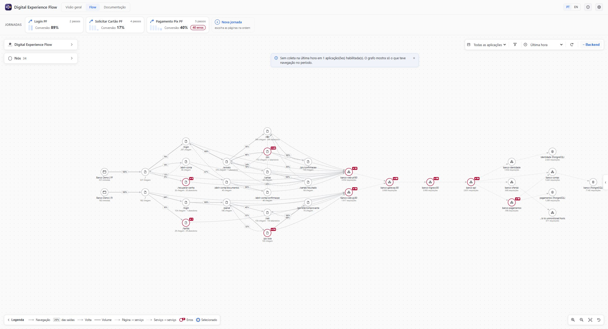
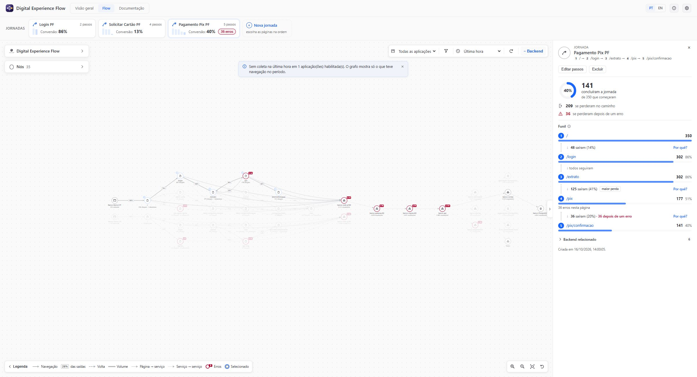
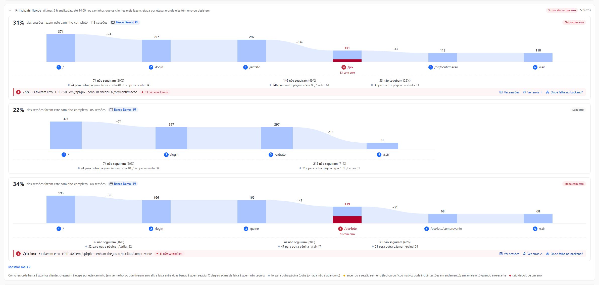
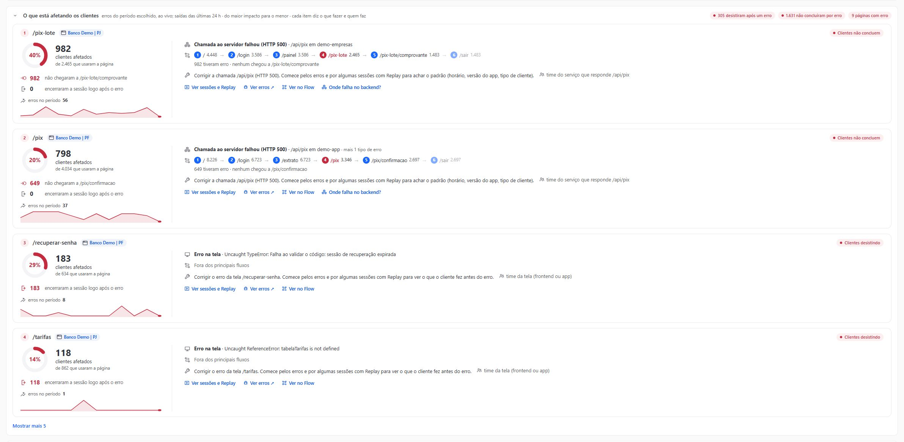
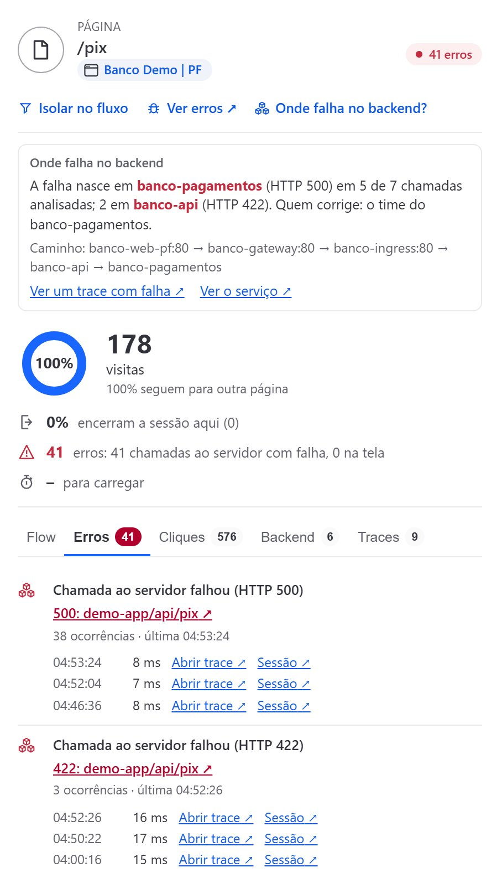
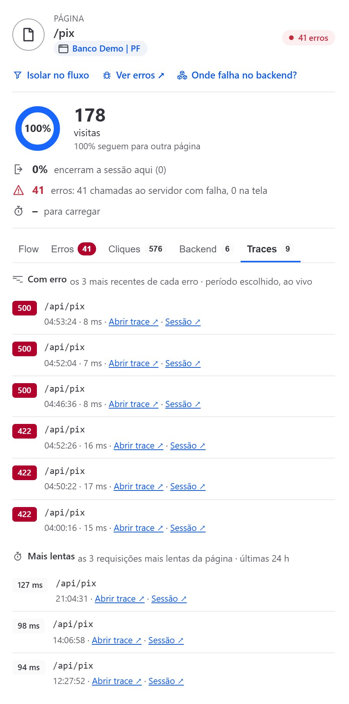
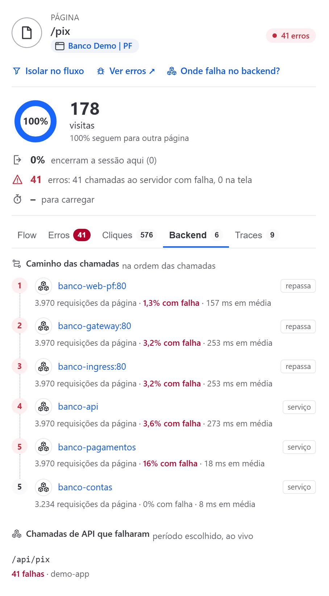
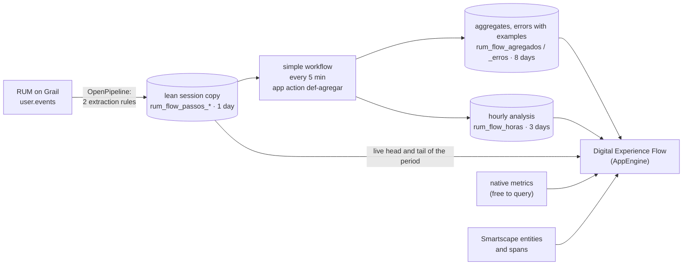

# Digital Experience Flow

**A Dynatrace app that turns RUM on Grail into a frontend "service flow"**: how people move through your web and mobile
applications, where they hit errors, where they give up, and which backend services each page calls.

[](https://github.com/Rbiaggio/dynatrace-digital-experience-flow/actions/workflows/ci.yml)
[](LICENSE)


[Português](README.pt-BR.md) · [Install](#install) · [Test it](#test-it) · [How it works](#how-it-works) · [Costs](#costs)



> Not an official Dynatrace product. Screenshots come from a demo lab with simulated traffic (`lab/`); no customer data.

## What it does

### Overview: what is affecting customers, right now

- Sessions, pages per session, sessions with errors and sessions that ended right after an error.
- Web Vitals Apdex with the pages that pull it down, and maps of where customers and errors are.
- "What is affecting customers": each error card shows the path to the failing step, how many did not continue, what to
  fix and who owns it, with shortcuts to sessions, Session Replay, errors and the backend.
- Improvement opportunities ranked by customer impact and effort, with a PDF report.
- Top flows as funnels, most visited pages and the list of sessions (errors first).

### Flow: the navigation graph, down to the database

- Pages as nodes and navigation as arrows, with the share of exits that took each path. The backend (services and
  databases) is linked to the pages that call it, from the Smartscape entities and the traces.
- Business journeys: pick the pages in order and get a per-session funnel. "Why?" on a step compares those who stopped
  with those who continued (errors on the previous page, where they went, the sessions).
- Click a page to drill down: its errors with the latest examples, the failed and slowest calls with their trace and
  session, the backend path in call order, and "Where does it fail in the backend?", which reads the traces of the
  latest failures and names the service where the failure starts and who fixes it.
- "Isolate" a page to see only the sessions that went through it.

### AI, on request only

- Dynatrace Assist (Davis CoPilot) explains a problem or an opportunity, inside Dynatrace.
- Optional structural root-cause analysis by an LLM you configure (bring your own key): problem, root cause, fix and
  benefit per opportunity, common causes and a 30/60/90-day plan. Masked evidence only, with the user's consent.
  The result reads from the overview to the detail, and the long model text stays one click away.

<p align="center"></p>

### Built for the people who run it

- Built-in documentation, Portuguese and English, light and dark themes.
- A Configuration screen that writes the OpenPipeline rules and buckets for you, and a cost calculator plus a real
  consumption card (from Dynatrace billing events).

| Flow | Journey funnel |
|---|---|
|  |  |

| Top flows as funnels (Overview) | What is affecting customers |
|---|---|
|  |  |

| Page drilldown: errors and where the failure starts | Traces: failed and slowest calls | Backend path of the page |
|---|---|---|
|  |  |  |

## How it works



- **The copy.** Two OpenPipeline rules set aside the few fields the app needs (navigation, errors, API calls and
  experience) as business events in the app's own buckets, with 1 day of retention. Nothing else in your pipelines
  changes: if user.events already go to a pipeline of yours, the rules go inside it (integrated mode) and the app
  refuses to apply if any existing rule would change.
- **The workflow.** Every 5 minutes, one simple workflow (no workflow-hour charge) runs the app's action: it reads each
  5-minute slice of the copy once and writes the totals (graph, Apdex, maps, clicks), the errors with three examples,
  and the hourly analysis (sessions, funnels, requests, page to service link).
- **The screen.** Each opening reads the small aggregate buckets plus the live start and end of the chosen period, with
  a shared 5-minute cache. An optional "every 5 minutes" mode skips the live part and reads even less.
- **No secrets in the browser.** Everything runs with the identity and permissions of the person who clicked. The
  optional LLM key lives only in the app function bundle.

## Requirements

- Dynatrace SaaS with AppEngine, Grail and OpenPipeline.
- RUM on Grail on the web and mobile applications you want to analyze.
- To deploy: Node.js 20.19 or later and a user (or platform token) allowed to install apps
  (`app-engine:apps:install`).

## Install

1. **Clone and point to your environment.**
   ```bash
   git clone https://github.com/Rbiaggio/dynatrace-digital-experience-flow.git
   cd dynatrace-digital-experience-flow/app
   ```
   Edit `app.config.json` and set `environmentUrl` to `https://<your-environment-id>.apps.dynatrace.com/`.

2. **Install the dependencies and deploy.**
   ```bash
   npm ci
   npm run deploy            # opens the browser to sign in; installs the app in the environment
   ```
   Non-interactive (CI): create a platform token with `app-engine:apps:install` and run
   `DT_APP_PLATFORM_TOKEN=<token> npm run deploy -- --non-interactive --no-open`.

3. **Grant access.** In Account Management > Identity & access management, create these policies and bind them to
   groups scoped to the environment.

   <details><summary>App users</summary>

   ```text
   ALLOW app-engine:apps:run WHERE shared:app-id IN ("my.digital.experience.flow", "dynatrace.launcher");
   ALLOW storage:buckets:read;
   ALLOW storage:bizevents:read;
   ALLOW storage:user.events:read;
   ALLOW storage:spans:read;
   ALLOW storage:metrics:read;
   ALLOW storage:entities:read;
   ALLOW storage:events:read;
   ALLOW state:app-states:read;
   ALLOW state:app-states:write;
   ALLOW settings:objects:read;
   ALLOW settings:schemas:read;
   ALLOW platform-management:effective-permissions:resolve;
   ```
   The last line is already in the built-in Admin, Pro and Standard User policies; without it, the Dynatrace Assist
   button does not show and the shared screen cache only serves that person (more reads).
   </details>

   <details><summary>Administrators (in addition to app users)</summary>

   ```text
   ALLOW settings:objects:write;
   ALLOW openpipeline:configurations:read;
   ALLOW openpipeline:configurations:write;
   ALLOW storage:bucket-definitions:read;
   ALLOW storage:bucket-definitions:write;
   ALLOW storage:system:read;
   ALLOW automation:workflows:read;
   ```
   Plus permission to create workflows in the Workflows app.
   </details>

   <details><summary>Workflow owner (in addition to app users)</summary>

   ```text
   ALLOW storage:events:write;
   ```
   The workflow runs with the permissions of whoever saves it.
   </details>

   <details><summary>Dynatrace Assist users (optional)</summary>

   ```text
   ALLOW app-engine:apps:run WHERE shared:app-id = "dynatrace.davis.copilot";
   ALLOW davis-copilot:conversations:execute;
   ALLOW davis-copilot:nl2dql:execute;
   ALLOW davis-copilot:dql2nl:execute;
   ```
   </details>

4. **Configure.** Open the app, click the gear (administrators only), select the applications and click **Apply
   configuration**. The list above the button says what will be created: 2 extraction rules, 7 buckets prefixed
   `rum_flow_`, 1 business events pipeline with its route.

5. **Create the workflow.** Click **Create the workflow**: the Workflows app opens already filled in, just save it.

The first numbers show up within 10 minutes. Flows, most visited pages, funnels and what is affecting customers come
from the hourly analysis: the first analyzed hour is ready within 2 hours of the configuration (the Overview shows
the expected time), and the last 24 hours fill in over the first day.

### Optional extras

- **Web Vitals Apdex.** The Experience card reads the metric `custom.rum.web_vitals.apdex_score`. If your environment
  does not compute it yet, [docs/apdex.md](docs/apdex.md) has a ready OpenPipeline pipeline (Core Web Vitals with
  Google's public thresholds), validated against the Settings API.
- **LLM analysis.** Off by default. [docs/llm.md](docs/llm.md) explains the key, the allowed list and the outbound
  connection.

## Test it

| What | Command | Needs a tenant? |
|---|---|---|
| Unit tests: LLM analysis (with a simulated LLM), cost model, maps, Session Replay | `cd app && npm test` | No |
| Type checks (UI and app function) | `npm run typecheck` and `npm run typecheck:api` | No |
| Build the app bundle | `npm run build` | No |
| Run the UI locally against your environment | `npm start` (dt-app dev server, signs in through the browser) | Yes |
| Generate real RUM traffic: demo bank with OneAgent and a load generator | see [docs/demo-lab.md](docs/demo-lab.md) | Yes |

The demo lab is how the app was proven: the load generator follows known proportions (for example 80% of visitors
click "Sign in"), writes them to a ground-truth file, and the graph in the app has to show the same numbers.

## Costs

Grail bills queries by GiB scanned, so the app was designed to read small aggregates instead of raw events:

- **Fixed:** the workflow, what it writes and the retention of the app's buckets.
- **Per use:** each screen opening reads the aggregates plus the live head and tail of the period. Filters,
  "Isolate" and "Why?" read the copy on demand, capped to the last hour for long periods; "Where does it fail in the
  backend?" reads a short window of spans.
- **Free:** native metrics, entities and App State.

Inside the app, Documentation > Costs has a calculator (your volumes and your rates) and Configuration > App
consumption shows what the app actually consumed, from Dynatrace billing events.

## Project structure

```text
app/                      the Dynatrace app (dt-app)
  app.config.json         id my.digital.experience.flow, environment URL, scopes
  ui/app/                 React UI (Strato), queries (lib/queries.ts), graph, docs tab
  actions/def-agregar.*   workflow action: 5-minute slices and hourly analysis
  api/                    app function of the optional LLM analysis
  scripts/                build helpers and the test runner (npm test)
lab/                      demo environment: demo bank (3 web channels), API gateway, BFFs, domain services with
                          Postgres and Redis, OneAgent application-only, Playwright load generator
docs/                     Apdex pipeline, LLM setup, demo lab
```

## Contributing

Issues and pull requests are welcome. Please run `npm test`, `npm run typecheck` and `npm run typecheck:api` before
opening a pull request. The code comments are in Portuguese; the UI is Portuguese and English.

## License

[MIT](LICENSE) © Rodrigo Biaggio
