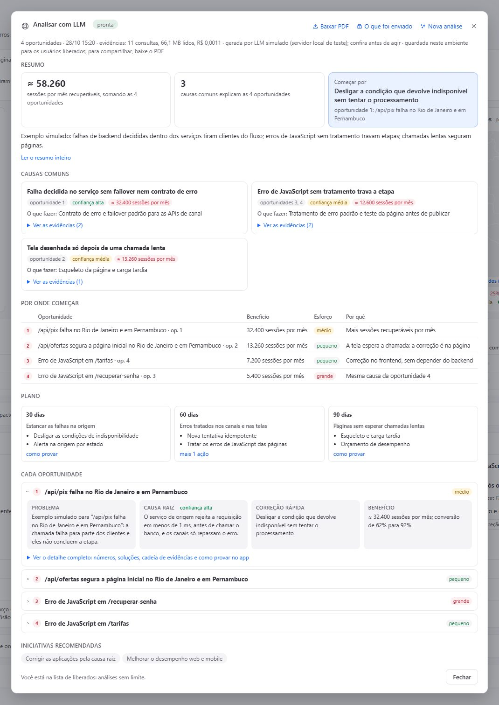

# LLM analysis (optional)

"Analyze with an LLM", at the bottom of the Overview's improvement opportunities, sends a masked evidence dossier for
each prioritized opportunity (up to 8) to an LLM you configure and shows, for each one, the problem, the root cause,
the quick and the structural fix and the benefit, plus a structural summary with common causes, priority, a 30/60/90-day
plan and recommended initiatives. It takes about 3 minutes and the result is stored in the environment (App State), with
a PDF download.

It is **off by default**: without configuration the button does not show for anyone.

## What the result looks like



The window reads from the overview to the detail:

- **Summary in numbers:** recoverable sessions per month (the sum of the opportunities with a measure), how many common
  causes explain the opportunities, and where to start (the first quick fix in the order). Below, the first sentence of
  the model's summary; the rest opens with "Read the whole summary".
- **Common causes:** one card each, with the opportunities it explains, the confidence, the impact in sessions per month
  and what to do. The evidence opens on demand.
- **Where to start:** the order of attack as a table, with benefit, effort and the main reason.
- **Plan:** 30, 60 and 90 days, two actions per wave; the other actions and how to prove the gain are one click away.
- **Each opportunity:** collapsed with its effort; open (the first in the order comes open), four short fields: problem,
  root cause with the confidence, quick fix and benefit. "See the full detail" has the numbers, every solution, the
  benefit math, the evidence chain, the hypotheses ruled out and how to prove it in the app.
- **Recommended initiatives:** tags for the kinds of work that fit (the catalog is editable and has no prices).

The header holds "Download PDF", "What was sent" (the dossiers exactly as they left, as JSON) and "New analysis"; a
line below says when it ran, what it read (queries, MB and cost) and which model answered. The PDF has the same parts.

## What is read and sent

Read in the environment with the identity of the person who asked, on request, with a read budget:

- a sample of up to 10 failing and 10 successful calls per endpoint and the spans of those traces only (service chain,
  exception and code line, timings, database and external calls);
- service and host metrics, sessions per day and errors per page; Davis problems and deployment events;
- what holds the LCP, JavaScript errors and app failures (a few short RUM reads), and the numbers already on screen.

Never sent: session ids, users and user tags, IPs, e-mails, CPF or CNPJ, tokens, URL parameters, ids in paths, trace
and span ids and server response bodies. Free text goes through the app's mask, and the dossier is checked in the
browser and again in the app function: if forbidden data is found, nothing is sent. "See what was sent" shows the
dossiers exactly as they left.

## Configure

1. **Create the local config** (it is in `.gitignore` and never goes to git):

   ```bash
   cd app
   cp api/lib/llm.local.example.ts api/lib/llm.local.ts
   ```

   The build also creates it from the example when it is missing, with the analysis off.

2. **Fill it in.** The app function speaks the Messages API in Anthropic's format (`POST {baseURL}/v1/messages` with
   `x-api-key` and `anthropic-version`), so it works with the Anthropic API or with a model from Anthropic deployed
   in Azure AI Foundry:

   ```ts
   export const LLM = {
     apiKey: "<your key>",
     baseURL: "https://api.anthropic.com",          // or https://<resource>.services.ai.azure.com/anthropic
     model: "<model id or deployment name>",
     liberados: ["@yourcompany.example", "ana@partner.example"],   // who may request the analysis (e-mails or whole domains)
   };
   ```

   Optional knobs (timeouts, effort and token ceilings per call, structured output) are listed in the example file.

3. **Allow the outbound call.** If the environment limits outbound connections of app functions (Settings > General >
   External requests, schema `builtin:dt-javascript-runtime.allowed-outbound-connections`), add the LLM host to the
   allow list.

4. **Deploy again** (`npm run deploy`). The key goes only into the app function bundle, never to the browser; still, it
   travels with the installed app artifact, so use a dedicated key you can revoke.

## Who can request it

Only the e-mails and domains in `liberados`, with no limit. The rule is enforced in the app function, not only on screen,
and no access policy opens it to anyone else. Setting `SOMENTE_LIBERADOS = false` in `app/api/lib/usoLlm.ts` gives
everyone else one analysis per environment (with a reservation so that two clicks at the same time do not both run).

## Cost

The environment pays only for reading the evidence (Grail scanned bytes, measured and shown at the end of the
analysis). The LLM tokens are billed by your provider.

## Tests

`npm test` runs the whole analysis (usage rule, function, prompt, masking, schema) against a simulated LLM on a local
server; nothing goes to a tenant or to a real provider.
